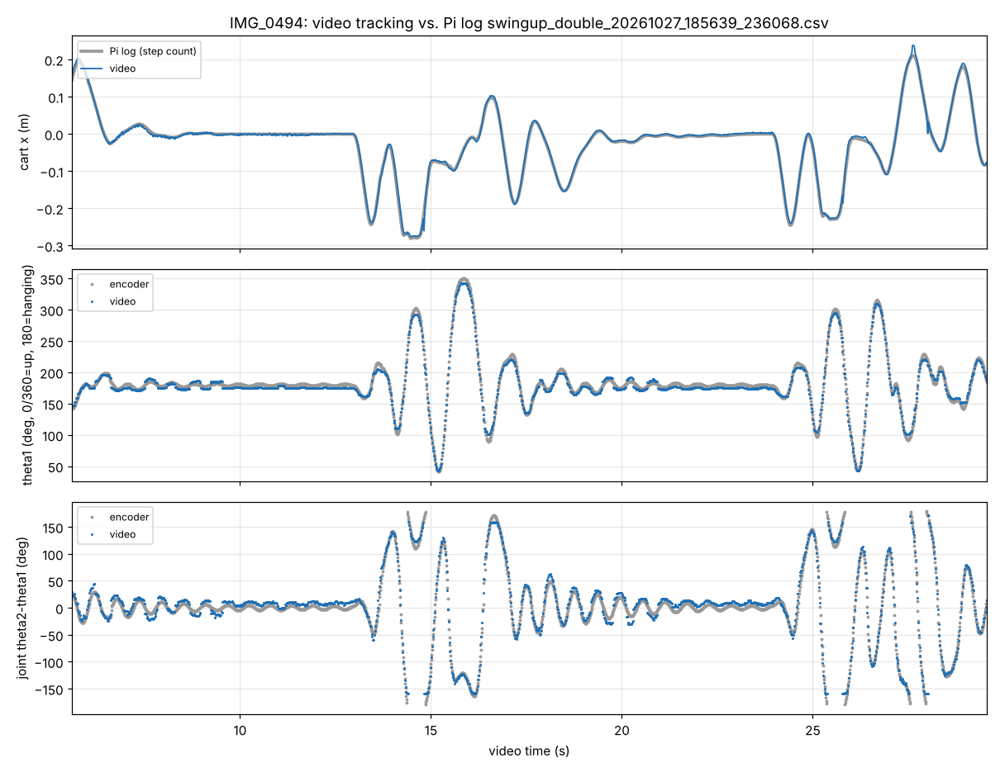
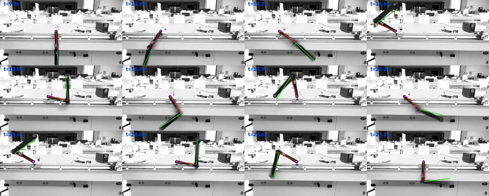
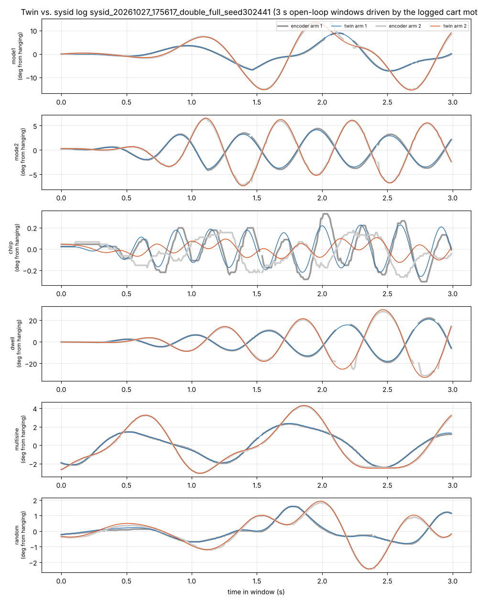
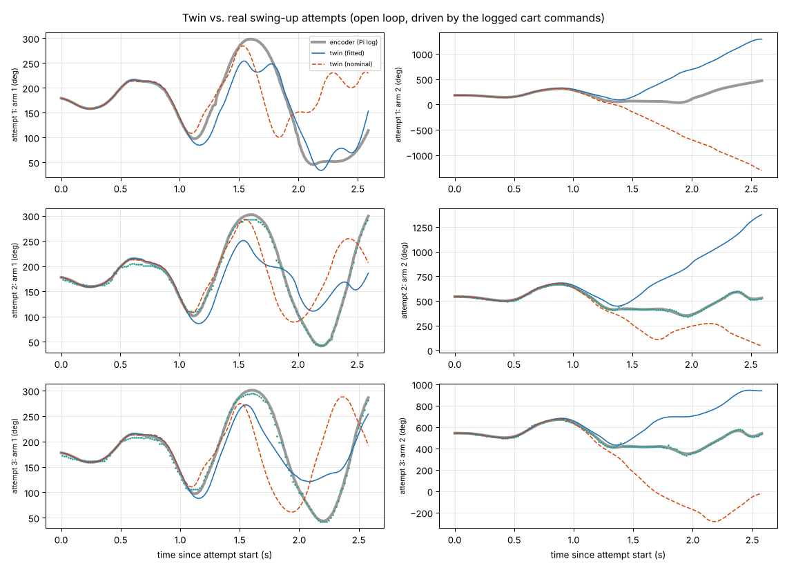
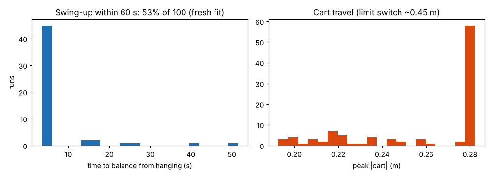
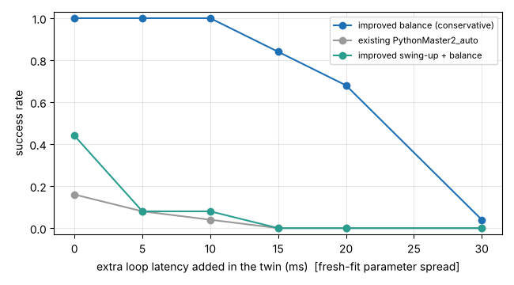
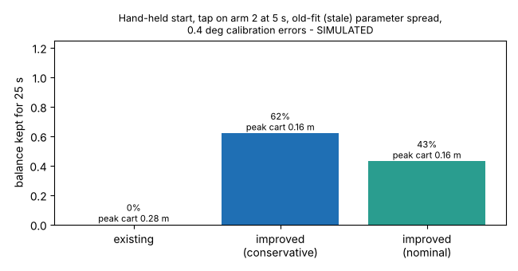
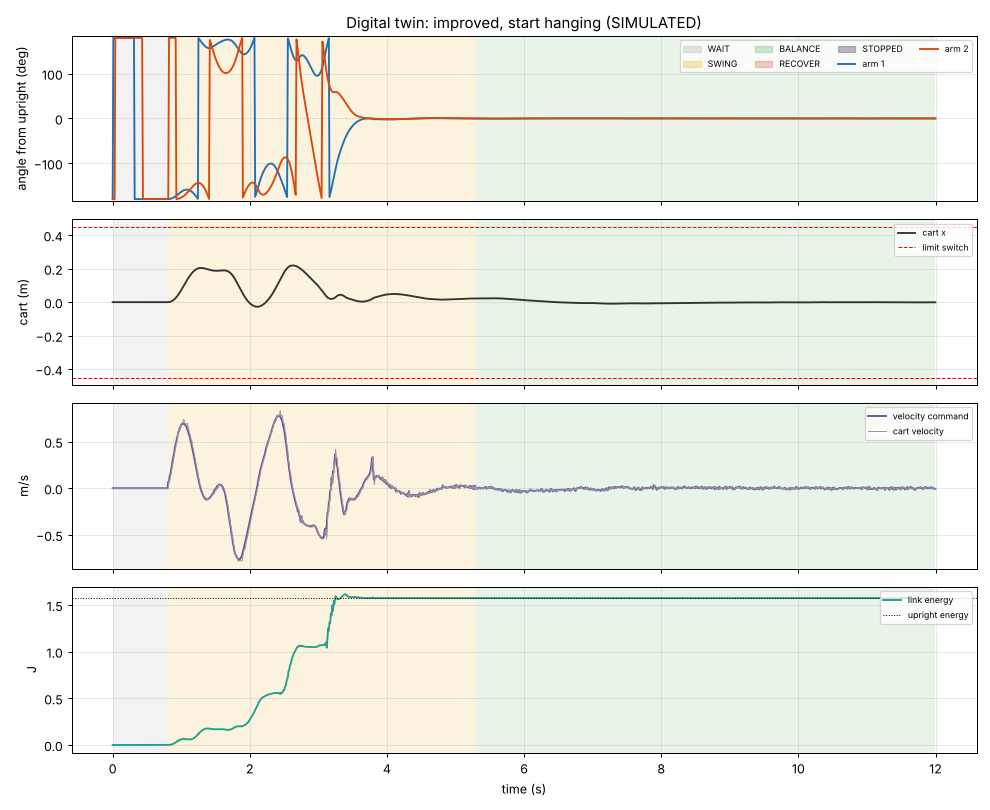
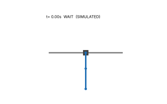

# Double-pendulum digital twin + improved controller

Branch `experiment/claude-controller-twin`. Nothing on `main` was changed; the
team's controllers (`PythonMaster2_auto.py`, `PythonMasterControl2.py`) are
untouched. Everything here is new:

| Path | What it is |
| --- | --- |
| `Code/DigitalTwin/` | Python twin of the rig, parameter fitting, validation, Monte Carlo, replay/animation |
| `Code/DigitalTwin/video_analysis/` | Tracking of `Media/IMG_0494_double_pendulum.mp4` (cart + both arm angles) |
| `Code/DoublePendulum/Improved/` | Improved controller, LQR design, swing-up planner, Pi entry script with `--sim` |

> **Simulation results are not hardware results.** The twin matches the
> recorded rig data well over short horizons (numbers below), but the swing-up
> has never run on the real rig. Follow the first-test checklist at the end.

---

## 1. What the video (and the matching Pi log) showed

The phone video is the run logged as
`swingup_double_20261027_185639_236068.csv` (logs branch). Cross-correlating the
tracked cart motion with every swing-up log picks that file with correlation
**0.999** (log time = video time + 0.55 s). That match gives a true pixel scale
(444 px/m at the cart) and, for free, encoder ground truth for the video
tracking. The script that produced it, `PythonMaster2_swingup.py`, exists only
on the Pi.

How the tracking works (`video_analysis/`): ORB features on the near plane
(desk edge, rail, cabinet) → RANSAC homography per frame onto one reference
frame (removes the hand shake); per-pixel 95th-percentile background so the
black arms stand out ("darkness" image); carriage template + Viterbi path for
the cart; ray scoring + Viterbi over angle bins for arm 1 from the pivot and
arm 2 from the elbow. The first ~5.5 s (close-up, moving camera) cannot be
registered and is skipped.





| Quantity (video, t = 5.6-29.5 s) | Value | Confidence |
| --- | --- | --- |
| Video vs. encoder, arm 1 | bias -3.6 deg, scatter 4.3 deg (1 sigma) | measured against the log |
| Video vs. encoder, joint (arm 2 - arm 1) | bias +5.5 deg, scatter 7.6 deg, 95 % within 17 deg | blur at high speed |
| Video cart vs. step count | 5 mm rms, 95 % within 10 mm | **no lost steps visible**; the step count can be trusted as cart position |
| Cart travel | -0.276 m ... +0.238 m | +/- 1 cm |
| Peak cart speed / accel | ~1.05 m/s / ~6.7 m/s^2 (99.5th pct, Savitzky-Golay) | accel +/- 30 % (double differentiation of video) |
| Hanging oscillation between attempts | ~1.7-1.8 Hz dominant in arm 1 | only 4-5 s windows: +/- 0.2 Hz |
| Pivot-to-elbow (visible) | 0.23 m (IQR 0.22-0.24) vs 0.20 m nominal | includes the elbow hub; perspective |
| Elbow-to-tip (visible) | 0.25 m (IQR 0.18-0.28) vs 0.25 m nominal | wide spread (blur) |
| L2/L1 visible ratio | 1.09 vs 1.25 nominal | **inconclusive** - measure the pivot-to-pivot distance with calipers |

What the current swing-up does (video + all 14 `swingup_double_*` logs):

* **33 swing-up attempts on 10/21 and 10/27, 0 catches.** Every attempt
  aborted 1.1-2.4 s into the 2.5 s plan (median 1.7 s) with a tracking error of
  12-37 deg (median 35.6 deg). In the video both arms do get above horizontal,
  arm 1 nearly to vertical, but with the arms folded, not stacked.
* From ~1.2 s to ~1.9 s into each filmed attempt **arm 2 stays almost still in
  absolute angle** (~60 deg from upright) while arm 1 sweeps through ~150 deg.
  The encoder and the video agree on this; the twin (free-swinging arms) does
  not reproduce it. Possible causes: the arm, hub or a cable touching the
  carriage/each other when folded, or much higher elbow friction at high joint
  speed. **Check with slow-motion video, close-up on the elbow and carriage.**
* Cart stayed inside +/-0.28 m; no limit-switch hits.
* 3 of 14 swing-up runs ended on "6 unusable angle frames in a row" (TX2
  `wireless_timeout`, radio age up to 104 ms). In the 10/27 system-ID run the
  arm-2 radio age reached 412 ms and the arm-2 data shows held values followed
  by jumps. **The arm-2 radio link is a real reliability problem.**

Other findings from the logs:

* The balancing loop period is bimodal, 8.2 ms or 12.3 ms (mean 10.0 ms). The
  repo's model is discretised at exactly 10 ms. The twin models this jitter;
  it matters a lot for swing-up (see section 3).
* The long successful balance runs (768 s on 10/21, 306 s on 10/16) used the
  Pi-only `PythonMaster2_auto_improved.py`, not the repo's
  `PythonMaster2_auto.py`. The Sept 30 runs of the repo controller lasted at
  most 25 s, and their `cart_m` jumps between about +3.26 and -3.26 m. That
  looks like the int16 step count wrapping or a misaligned 2-byte reply, not
  real motion. **Please commit the Pi-only scripts** (`PythonMaster2_swingup.py`,
  `PythonMaster2_auto_improved.py`, the sysid script) so they are versioned.
* Step-rate quantisation: the Arduino timer value is truncated with `int()`, and
  the tick is 4 us (prescaler 64). At 1 m/s the achievable speeds are
  0.96 / 1.04 / 1.13 m/s, steps of about 8 %. A prescaler of 8 in
  `ArduinoSlave.ino`, plus rounding instead of truncation, would make those
  steps about 8x finer.

## 2. The digital twin

`twin_model.py`: Lagrangian double pendulum on a **kinematic** cart (the
closed-loop stepper follows the commanded pulse train, so the cart mass drops
out of the link dynamics; the cart is modelled as a critically damped servo on
the pulse position with an acceleration ceiling). Viscous + Coulomb friction at
the pivot and at the elbow (elbow torque acts on the relative rate, unlike the
old symbolic model). Nominal values come from `Code/Global/physical_parameters.py`.

`twin_sim.py`: the rig around it, stepped exactly like the Pi loop. It models
14-bit encoder quantisation plus noise, the TX 200 Hz sample age, radio/USB
delay, lost frames, calibration offsets, the Pi loop period with jitter, the
Arduino timer quantisation (same mapping code as `PythonMaster2_auto.py`), the
actuator delay, limit switches at +/-0.45 m (the Arduino disables the driver)
and the motor-disable command.

### Fitted parameters (`fit_parameters.py`, `fitted_parameters.json`)

Fitted to the team's two system-ID runs (logs branch, `sysid_*`; free decays,
chirp, dwell, multisine, random cart motion) by multiple shooting: 3 s
open-loop windows that start from the measured state and are driven by the
logged cart commands. Samples with radio age > 12 ms are excluded. The most
recent run (10/27, same day as the video) defines the twin; sigma combines the
Jacobian with the 10/16 vs 10/27 difference.

| Parameter | Value | 1 sigma | Notes |
| --- | --- | --- | --- |
| J1 = m1 l1^2 + m2 L1^2 + I1 | 0.01202 kg m^2 | 0.00034 | nominal 0.01120 (+7 %) |
| J2 = m2 l2^2 + I2 | 0.00410 kg m^2 | 0.00037 | nominal 0.00434; **10/16 fit was 0.00484** |
| c = m2 L1 l2 | 0.00433 kg m^2 | 0.00012 | nominal 0.00445 |
| h2 = m2 l2 | 0.0202 kg m | 0.0016 | nominal 0.0223; **10/16 fit was 0.0234** |
| h1 = m1 l1 + m2 L1 | 0.0600 kg m | held | only M^-1 G is identifiable from link motion |
| b1 pivot viscous | 1.8e-4 N m s | 1.9e-4 | |
| c1 pivot Coulomb | 3.1e-4 N m | 1.5e-4 | |
| b2 elbow viscous | 4e-5 N m s | 2e-5 | |
| c2 elbow Coulomb | 1.0e-4 N m | 1.6e-3 | **10/16: 3.4e-3 N m**: the elbow changed between sessions |
| sensor delay (excl. TX sample age) | 3.6 ms | 1.5 ms | |
| stepper servo time constant | 2 ms (at bound) | 13 ms | not identifiable from these tests; Monte Carlo uses 2-25 ms |

Fit quality: 0.62 deg rms (10/27), 0.39 deg rms (10/16). Hanging modes 0.873 /
1.792 Hz (nominal model 0.892 / 1.900; logs 0.86-0.89 / 1.79 Hz).



**Something on arm 2 changed between 10/16 and 10/27.** J2, h2 and the elbow
friction moved by 10-15 % and 30x respectively (maybe the TX2 board/battery
mount, or the elbow bearing). The swing-up is sensitive to exactly these
numbers, so **re-run the sysid script and `fit_parameters.py` whenever the arms
are touched.**

### Validation on data not used for fitting (`validate_twin.py`)

The three real swing-up attempts from the filmed run. The twin starts from the
logged state, open loop, driven by the logged cart commands:

| Horizon | arm 1 rms error | arm 2 rms error |
| --- | --- | --- |
| 0.5 s | 0.4 deg | 1.7 deg |
| 1.0 s | 1.7 deg | 5.8 deg |
| 1.5 s | 19 deg | 24 deg |



The divergence after ~1.1 s comes partly from chaos: large folded swings
amplify any small error. Part of it is the arm-2 "plateau" described above,
which the twin does not have. Errors under 2 deg / 6 deg over 1 s are enough
for designing feedback; long open-loop predictions of large swings are not
trustworthy.

## 3. The improved controller (`Code/DoublePendulum/Improved/`)

| File | Role |
| --- | --- |
| `improved_controller.py` | The controller (NumPy only; same object on the Pi and in the twin) |
| `design_lqr.py` → `improved_gains.json` | LQR + Kalman design on the fitted model (profiles `conservative`, `nominal`, `catch`) |
| `swingup_trajectory.py` → `swingup_plan.json` | Offline swing-up plan + time-varying LQR (TVLQR) tracking gains |
| `plan_model.py` | One-cycle model of how the Pi actuates (velocity steps + loop latency), shared by planner and controller |
| `stepper_mapping.py` | Velocity ↔ Arduino timer command, identical to `PythonMaster2_auto.py` |
| `PythonMaster2_improved.py` | Pi entry script (reuses `PythonMaster2_auto.py`'s serial/calibration helpers and `Global/`); `--sim` runs it in the twin |

Modes: `WAIT → SWING → BALANCE`, with `RECOVER` (brake the swing, re-centre,
wait for calm, retry) and a latched `STOPPED`.

* **Balance:** discrete LQR designed for what the hardware actually does. The
  command is a cart velocity held for one cycle, with ~9 ms loop latency, so
  the LQR uses the transformed rates w~ = w - Bq·v, a split-interval
  zero-order hold and a cost on cart acceleration. A Kalman filter estimates
  the link states, and an integral of cart position removes the drift caused
  by small encoder-calibration errors. The existing script instead uses a
  force-input model and a manual `upright1 += cart/60 + v/30` trim. Hold
  profile for first tests: `conservative`.
* **Swing-up:** the energy method requested for this experiment is implemented (`swing_mode =
  "energy"`: a = -k(E* - E)·sat(y), plus joint-motion damping and cart
  centring). In the twin it raises the energy to the upright value in ~2 s,
  but the two arms then tumble chaotically. In 60 s runs it almost never passed
  the upright slowly enough to catch (Monte Carlo below). The default is
  therefore `swing_mode = "trajectory"`. An offline-optimised 3.0 s plan,
  seeded with energy-pumping and sinusoidal guesses, raises both arms to
  upright within ±0.22 m, ≤0.8 m/s and ≤7 m/s^2. The controller follows it
  with TVLQR feedback and a model-based observer. The observer re-times each
  sample using the receiver's `radio_age` field: TX1/TX2 sample at 200 Hz
  unsynchronised with the 10 ms frames, and that 0-5 ms age jitter alone
  broke tracking in the twin. Then hand-off to LQR. Same idea as the team's
  Pi-only planner, but the plan, gains and latency model are designed on the
  fitted twin and checked against its noise and jitter.
* **Catch/recovery:** the plan's final upright LQR holds for 1.5 s, then
  `BALANCE` with the hold profile. If either arm passes 35 deg → `RECOVER` →
  retry (up to `MAX_ATTEMPTS`). A tracking error > 30 deg aborts the attempt.
* **Safety:** speed limit 1.0 m/s; accel limits of 12 m/s^2 while tracking
  and 15 m/s^2 for the catch (the hold gains rarely need 3); a
  braking-distance governor so the cart can always stop inside the ±0.28 m
  soft limit; e-stop beyond ±0.36 m (limit switches are at ~±0.45 m); stop
  after more than 3 consecutive unusable frames, a balance-only drop, or too
  many attempts. Every e-stop first **brakes the cart to rest with the motor**
  (8 m/s^2) and only then sends the disable command: the twin showed that
  disabling at 2 m/s lets the cart coast into a limit switch. A loop stall
  > 50 ms or non-finite data disables immediately. Ctrl+C, any exception and
  the run-time limit → motor-disable command (0xFFFFFFFF).

## 4. Validation in the twin (Monte Carlo, `monte_carlo.py`)

Every run draws its own twin. "Fresh fit" means inertial constants within
1-1.5 % of the fit (~5x the single-run Jacobian sigma), friction x0.7-1.4,
servo time constant 2-15 ms. "Stale fit" uses the 10/16 vs 10/27 spread:
4-6 % on inertias, friction x0.5-2.5, the 10/16 elbow friction in half the
runs, servo 2-25 ms. All runs also randomise sensor delay (2-8 ms), lost
frames (0-1 %), loop jitter (0.5-2 ms), encoder noise and 0.4 deg (1 sigma)
calibration errors. Full numbers: `monte_carlo_results.json`.

| Scenario (SIMULATED) | Runs | Result |
| --- | --- | --- |
| **Swing-up from hanging, fresh fit**, 60 s, retries allowed | 100 | **53 % balanced** (95 % CI 43-63 %); about **1 in 6 attempts** catches; median time to balance 3.5 s when the first attempt works, 90th percentile 16 s; peak cart 0.28 m (soft limit), 0 limit-switch hits |
| Swing-up, stale fit | 50 | 6 % (about 1 % per attempt). **Re-identify before swing-up sessions.** |
| Swing-up, energy method (`swing_mode="energy"`) | 25 | 0 % in 60 s (energy reaches the upright value, but the arms never arrive together slowly enough to catch) |
| Balance from a hand-held start, no disturbance, fitted twin, no calibration error | 12 | improved (conservative) 12/12 · existing `PythonMaster2_auto` 6/12 (also 6/12 in a twin built from the nominal parameters, so the gap is not just "designed on the twin") |
| Balance, stale fit + 0.4 deg calibration errors + 0.3-0.8 rad/s tap on arm 2 at 5 s | 100 each | improved conservative **62 %**, improved nominal 43 %, existing 0 % (32 limit-switch hits: its slow `upright1` trim does not hold the cart against these offsets) |
| Balance vs. extra loop latency, fresh fit, no tap | 25 per point | improved: 100 % up to +10 ms, 84 % at +15 ms, 68 % at +20 ms, 4 % at +30 ms · existing: 16 % at +0 ms, 0 % from +15 ms |
| Swing-up vs. extra loop latency (40 s) | 25 per point | 44 % at +0 ms, **8 % at +5 ms**, 0 % from +15 ms |







How to read this:

* The **balance** controller should beat the current one on the rig. It has
  integral action against calibration offsets and a latency-aware design,
  and it kept full success up to +10 ms of extra latency. Its tail rms in the
  twin is about 0.1 deg (arm 1). Expect several times more on hardware.
* The **swing-up** works in the twin but sits on a knife edge. It needs J2
  and h2 to ~1-2 %, the loop latency within a few ms of the design value
  (9 ms from measurement to command), and no extra loop delay: printing in
  the loop, a slower Pi or more radio buffering would break it. The twin's
  prediction of real swing-up success is the least certain number here.
  Large folded swings are where the twin's open-loop error grows fastest
  (section 2). Treat it as "worth trying after re-identification", not
  "expected to work".
* Example runs (all marked SIMULATED): `sim_runs/SIMULATED_improved_swingup.gif`
  / `.png` / `.csv`, `sim_runs/SIMULATED_improved_balance.*`,
  `sim_runs/SIMULATED_existing_balance.*`. The CSVs open in
  `Code/RunReview/balancing_visualizer.html`.





## 5. How to run

On a laptop (Python 3 with numpy, scipy, matplotlib; opencv only for the video):

```sh
cd Code/DigitalTwin
python3 replay.py                                    # improved swing-up from hanging, 20 s
python3 replay.py --controller legacy --start upright --duration 15
python3 replay.py --start upright --profile nominal  # improved balance only
# -> run_logs/SIMULATED_*.png / .gif / .csv / .json
#    open the .csv in Code/RunReview/balancing_visualizer.html
python3 monte_carlo.py --runs 100                    # ~30 min on 2 cores
```

The same controller through the Pi entry script, but in the twin:

```sh
python3 Code/DoublePendulum/Improved/PythonMaster2_improved.py --sim --duration 20
python3 Code/DoublePendulum/Improved/PythonMaster2_improved.py --sim --balance-only
```

On the Pi (find the checkout ID with `engt status`; the branch name contains a
slash, so the folder gets a digest):

```sh
engt run experiment/claude-controller-twin Code/DoublePendulum/Improved/PythonMaster2_improved.py
```

The run settings are at the top of `PythonMaster2_improved.py` (`GAIN_PROFILE`,
`SWING_MODE`, `MAX_SPEED_M_S`, `SOFT_LIMIT_M`, `ESTOP_LIMIT_M`,
`MAX_ATTEMPTS`, `RUN_SECONDS`). `--balance-only` mirrors the current
hand-held upright start. CSVs go to `Code/DoublePendulum/run_logs/improved_double_*.csv`
(git-ignored and backed up like the other controllers). Only NumPy and
pyserial are needed on the Pi; scipy is only needed for the design scripts.

After re-measuring or re-identifying the arms (laptop):

```sh
python3 Code/DigitalTwin/fit_parameters.py <sysid_run_dir> [...]   # -> fitted_parameters.json
python3 Code/DoublePendulum/Improved/design_lqr.py                  # -> improved_gains.json
python3 Code/DoublePendulum/Improved/swingup_trajectory.py          # -> swingup_plan.json (~10 min)
python3 Code/DoublePendulum/Improved/swingup_trajectory.py --polish # refine the stored plan
python3 Code/DigitalTwin/monte_carlo.py --runs 50 --scenarios swingup
```

Video analysis (the stabilised stack is ~300 MB, so it is not committed):

```sh
cd Code/DigitalTwin/video_analysis
python3 stabilize.py ../../../Media/IMG_0494_double_pendulum.mp4 /tmp/stab.npz
python3 track_video.py /tmp/stab.npz /tmp/track
python3 analyze_video.py /tmp/stab.npz /tmp/track/track_raw.npz --log <swingup_double_20261027_185639_236068.csv>
python3 ../validate_twin.py <same log>
```

Tests (all hardware-free):

```sh
(cd Code/DigitalTwin && python3 -m unittest discover -s tests -p 'test_*.py')
(cd Code/DoublePendulum/Improved && python3 -m unittest discover -s Tests -t . -p 'test_*.py')
```

## 6. First hardware test checklist

Do these in order; do not skip to swing-up.

1. **Bench checks, motor power OFF.** Run `Code/Global/AngleSensorDiagnostic.py`
   for 2 min while swinging the arms by hand. Both channels `valid`, radio age
   < 15 ms. Fix TX2 first if it drops out (see section 1).
2. Measure and write down: pivot-to-elbow distance, rail travel between the
   limit switches, which direction is +x. Confirm the limit switches stop the
   motor (push the cart onto each switch by hand with the motor enabled at
   zero speed).
3. **Balance only, conservative:** `PythonMaster2_improved.py --balance-only`
   with `GAIN_PROFILE = "conservative"`. Hold both arms upright as with the
   current script. One person runs the rig and keeps a hand on the stop
   button; nobody in the swing plane. Run at least three times, 30 s each.
   Check the CSV: arm angles stay within a few degrees; cart within ±0.1 m.
4. Tap test while balancing (light finger tap on arm 2). Then try
   `GAIN_PROFILE = "nominal"`.
5. **Re-identify**: run the team's sysid script, then `fit_parameters.py` →
   `design_lqr.py` → `swingup_trajectory.py` (laptop), commit, let the Pi
   sync. The swing-up only works in the twin when J2/h2 are known to ~2 %.
6. **Swing-up dry run with reduced range:** set `MAX_ATTEMPTS = 1`,
   `RUN_SECONDS = 15`, clear the area (the arms sweep a 0.45 m radius above and
   below the rail), type `GO`. Expect: WAIT ~1 s, a 3 s swing, then
   BALANCE or an abort/RECOVER. Record slow-motion video of every attempt.
7. Compare each attempt's CSV with the plan: `replay.py` + `validate_twin.py`
   style overlays. If the tracking error grows in the same place every time,
   re-fit with that run included.
8. Only then raise `MAX_ATTEMPTS`.

Safety stops built in: soft limit ±0.28 m (braking governor), e-stop ±0.36 m,
> 3 missing frames, a loop stall > 50 ms, the run-time limit, Ctrl+C. The
Arduino's limit switches and the stop button remain the hardware backstop.

## 7. Plots and screenshots for notes and lab reports

* `video_analysis/video_vs_log.png`: video tracking vs. encoder log (shows that
  both the tracking and the step-count cart position are trustworthy)
* `video_analysis/video_overlay_frames.jpg`: tracked skeleton on video frames
* `video_analysis/video_cart_kinematics.png`: cart speed/acceleration from video
* `plots/fit_sysid.png`, `plots/fit_sysid_earlier_run.png`: twin vs. sysid
  data (shows the 10/16 → 10/27 hardware change)
* `plots/validation_swingup.png`: twin vs. real swing-up attempts
* `plots/monte_carlo_*.png`: success rates, cart travel, latency robustness
* `sim_runs/*.gif` and `*.png`: simulated swing-up and balance (label them
  SIMULATED)
* From the rig: a slow-motion clip of the arm-2 "plateau", the
  `AngleSensorDiagnostic` radio-age output, and the first improved-controller
  balance CSV opened in `balancing_visualizer.html`

## 8. Open questions / to check on the rig

* The arm-2 plateau during folded swings (contact? friction?). The twin cannot
  predict swing-ups that rely on it.
* Pivot-to-elbow distance (the video suggests ~0.23 m visible, nominal 0.20 m).
* Stepper servo bandwidth (not identifiable from the sysid moves; a step-response
  test with a filmed cart would pin it down).
* Whether the motor can follow the plan's 7 m/s^2 with the arms on.
  `UIM5756PM` torque at that rate is untested here.
* The loop period's 8.2/12.3 ms bimodality. Driving the loop from the receiver
  frame timestamp would remove most of it.
